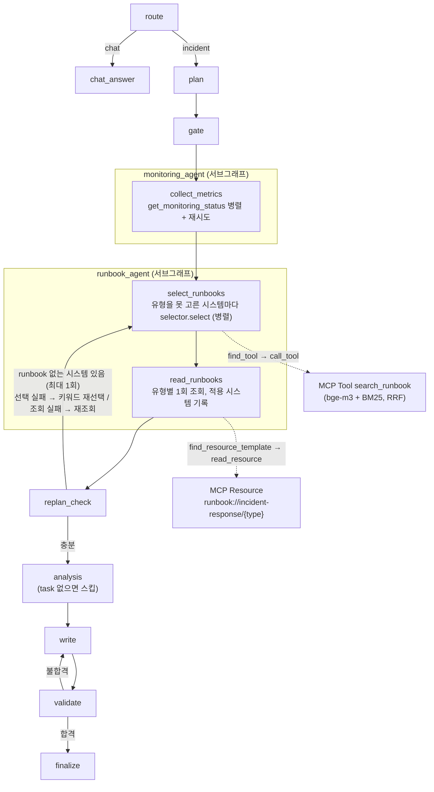
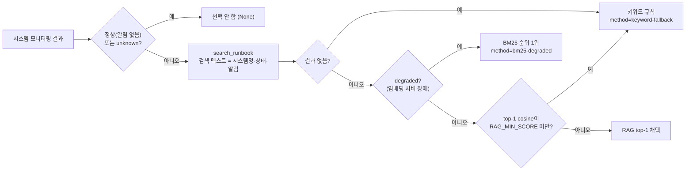

# 개선 내역 — RAG 기반 시스템별 runbook 선택 + 조사 서브 에이전트

개선 전 원본은 수업에서 받은 Base `all_total_vue_student`(이 저장소에는 없음 — 이 폴더 옆에 두면 `eval/tools/check_data.py`가 원본과 대조한다)이고, 이 폴더가 개선 후다.
아래 수치는 전부 `eval/results/`의 결과 파일에서 그대로 옮겼다.

## 한눈에 보기

e2e 12건(정답 (시스템, runbook) 쌍 17개), fake LLM(결정론). 세 서버 모두 **같은 증강 데이터**(runbook 14종, 시스템 15개)로 돌렸다. 개선 전 코드는 원본 폴더를 복사한 뒤 `data/`만 이 폴더 것으로 덮어 띄웠다.

| 지표 | 개선 전 코드 | 개선 후 + 키워드 규칙 | 개선 후 + hybrid RAG |
|---|---|---|---|
| 정답 runbook을 읽은 쌍 | 5/17 (0.294) | 6/17 (0.353) | **16/17 (0.941)** |
| └ 원본 5개 시스템 (6쌍) | 5/6 | 6/6 | 5/6 |
| └ 신규 9개 시스템 (11쌍) | 0/11 | 0/11 | **11/11** |
| 케이스가 정확히 맞은 비율 | 0.25 | 0.333 | **0.917** |
| 불필요하게 읽은 runbook 수 | 7 | 9 | 1 |
| 지연 중앙값 / 최대 (s) | 0.736 / 1.199 | 0.74 / 1.197 | 0.798 / 1.272 |
| 가상 비용 합계 (USD) | 0.008059 | 0.008904 | 0.010144 |

이 표를 읽는 법:
- **RAG만의 효과는 가운데 열 → 오른쪽 열이다**(같은 코드·같은 데이터, 선택기만 교체): 6/17 → 16/17.
- 늘어난 10쌍은 **전부 신규 9개 시스템**에서 나왔다(0/11 → 11/11). 이 11쌍 중 9쌍은 키워드 규칙이 애초에 출력할 수 없는 유형(cert-expiry, db-lock 등 신규 8종)이고, 나머지 2쌍(recommend-service의 memory-leak)은 알림에서 `memory`·`heap`을 일부러 뺐다(`check_data.py`가 강제). 그래서 이 숫자는 "같은 유형을 더 잘 고른다"가 아니라 **"규칙에 없는 유형까지 덮는다"**를 잰다.
- 원본 5개 시스템만 보면 hybrid(5/6)가 키워드 규칙(6/6)보다 한 쌍 낮다. e03 cache-service에서 memory-leak과 disk-full이 RRF 점수로 정확히 동점이 났고, 동점 처리 규칙(cosine 비교)에서 disk-full이 0.0007 차이로 이겼다(§6.2).
- 개선 전 코드 → 개선 후 + 키워드 규칙(5 → 6)은 시스템별 선택의 효과다. e03에서 두 시스템의 runbook을 각각 읽는다.
- 비용은 RAG만 놓고 보면(키워드 → hybrid) +13.9%, 개선 전 코드와 비교하면 +25.9%다. 답변에 runbook이 여러 개 들어가 길어졌기 때문이다. 지연은 중앙값 기준 +0.06s(질의 임베딩)다.

runbook 선택기 단독(selector_cases 40건) top-1 — `eval/results/selector_20261020-160740.json`:

| 범주 (건수) | 키워드 규칙 | hybrid | vector |
|---|---|---|---|
| 전체 (40) | 12/40 (30.0%) | 33/40 (82.5%) | 36/40 (90.0%) |
| keyword (12) — 규칙 키워드가 있고 규칙이 맞는 케이스 | 12/12 | 9/12 | 11/12 |
| paraphrase (18) — 규칙 키워드가 없는 케이스 | 0/18 | 15/18 | 17/18 |
| trap (10) — 규칙 키워드가 엉뚱한 유형을 가리키는 케이스 | 0/10 | 9/10 | 8/10 |

- 키워드 규칙 열의 12/12 · 0/18 · 0/10은 측정값이 아니라 **데이터 설계값**이다. `check_data.py`가 keyword 범주는 규칙이 맞고 나머지 28건은 규칙이 틀리도록 단언(assert)한다. 30%는 규칙의 실제 정확도가 아니다.
- 규칙이 맞도록 만든 keyword 범주에서는 hybrid(9/12)가 규칙(12/12)보다 낮다.

## 1. 문제 → 변경

| # | 개선 전 문제 | 변경 |
|---|---|---|
| 1 | runbook을 키워드 표(`latency→high-latency`, `timeout→network-timeout` …, 없으면 `db-down`)로 골랐다. 알림 문구가 표의 단어와 다르면 무조건 `db-down`, `Lock wait timeout` 같은 문장은 `timeout`에 낚여 `network-timeout`이 됐다. | **RAG 검색**: runbook의 `## 증상` bullet을 청크로 나눠 bge-m3 임베딩(cosine) + BM25를 RRF로 합친다. MCP Tool `search_runbook`으로 노출한다. |
| 2 | 시스템이 여러 개여도 모든 시스템의 알림을 한 문자열로 합쳐 runbook을 **하나만** 골랐다 (e03: cache-service는 memory-leak, gateway-service는 network-timeout인데 memory-leak 하나만 읽음). | **시스템별 선택**: 장애 시스템마다 따로 고르고, 같은 유형끼리 묶어 한 번씩만 읽는다. 답변에 runbook마다 적용 시스템을 적는다. |
| 3 | runbook 6종·시스템 6개뿐이라 키워드 표로도 대부분 맞았다 — 개선 효과를 잴 수 없었다. | **데이터 증강**: runbook 14종(기존 6종은 단계 원문 유지 + 증상 섹션), 시스템 15개, 평가셋 selector 40건 / e2e 12건. 표층 누수 검사 포함 (`eval/README_data.md`, 한계는 §7). |
| 4 | `research` 노드 하나가 모니터링 조회와 runbook 조회를 다 했다. | **서브 에이전트 2개**: `monitoring_agent`(collect_metrics), `runbook_agent`(select_runbooks → read_runbooks). 각자 컴파일된 LangGraph이고 메인 그래프에 노드로 붙는다. |
| 5 | 계획(plan)에 runbook 조회가 없어서 **모든** 장애 요청이 replan_check에서 "runbook 없음 → 추가 조사" 라운드를 탔다. 재계획이 예외 처리가 아니라 정상 경로였다. | **Dynamic Planning 재정의**: runbook 선택이 계획된 단계가 됐고, replan_check는 "장애 시스템마다 runbook이 붙었는가"를 검사한다. 빠진 시스템이 있을 때만 1회 다시 조사한다 — 선택기가 실패한 시스템은 키워드 규칙으로 다시 고르고, 조회만 실패한 시스템은 이미 고른 유형을 다시 읽는다. |
| 6 | `agent/graph.py` 한 파일에 노드 10개·규칙·상태가 다 있었다. | **모듈화**: `state.py`, `rules.py`, `runbook_selector.py`, `agents/`, `nodes/`(파일 하나에 노드 하나). |
| 7 | 선택 방식을 바꾸려면 노드 코드를 고쳐야 했다. | **DI**: `SupervisorDeps.runbook_selector`. 서버가 `RUNBOOK_SELECTOR`로 만들어 주입하고, 노드는 `selector.select()`만 부른다. |
| 8 | 테스트가 없었다. | **pytest 87개**: 규칙, RAG(네트워크 없이, 임베딩 타임아웃·서킷 브레이커 포함), 선택기(조작한 검색 결과), 노드, 그래프 전체(fake LLM + FakeMCP, Tool 오류·runbook 조회 실패 주입). |
| 9 | Before/After를 잴 방법이 없었다. | **`eval/run_eval.py`**: selector / threshold / e2e / compare 서브커맨드. 개선 전 서버에도 그대로 돌아간다. |
| 10 | (실모델에서 발견) 소형 모델(qwen3:0.6b)이 계획에서 시스템명을 틀리게 쓰면, 보정 코드가 그 이름을 '쿼리에서 처음 나온 시스템'으로 바꾸고 중복으로 버려 **그 시스템 조사가 통째로 빠졌다** (e10 reporting-service, e12 recommend-service·gateway-service). | **계획 보정**: 쿼리에 이름이 그대로 나온 시스템은 모델이 빠뜨려도 항상 조사한다(`ollama_llm.py`·`openai_llm.py`의 `plan()`). 모델 판단을 코드로 바로잡는 권위 게이트와 같은 원칙. 재현 테스트 `tests/test_plan_guard.py`. |

## 2. 새 그래프



runbook 선택기(`McpRagSelector.select`)의 판단 순서:



`/chat/stream`은 `subgraphs=True`로 스트리밍해서 서브 에이전트 안쪽 노드(collect_metrics, select_runbooks, read_runbooks)가 끝날 때마다 이벤트가 나간다. 이벤트에 `node`와 `agent`(어느 서브 에이전트인지)가 붙는다. runbook_agent가 내는 이벤트는 `RunbookSelected`, `RunbookSkipped`(정상 / 모니터링에 없는 시스템), `TaskCompleted`, `RunbookShared`(이미 읽은 유형에 시스템 추가), `RunbookReadFailed`다.

## 3. 변경 파일 지도

| 파일 | 상태 | 내용 |
|---|---|---|
| `rag/embedder.py` | 신규 | Ollama bge-m3 임베딩. 청크 벡터는 `data/.rag_cache/`에 sha1(text) 키로 디스크 캐시, 질의는 메모리 캐시. 질의 타임아웃 5s, 실패하면 30s 동안 요청 없이 바로 `EmbeddingUnavailable`(서킷 브레이커) |
| `rag/bm25.py` | 신규 | 토크나이저(영문 단어 + 한글 어절·글자 bigram) + BM25Okapi 직접 구현 |
| `rag/index.py` | 신규 | `RunbookIndex.search(query, top_k, mode)` — vector / bm25 / hybrid(RRF). 임베딩 실패 시 BM25로 내려가고 `degraded=True` |
| `mcp_server.py` | 수정 | Tool `search_runbook` 추가 (기존 Tool/Resource/Prompt는 그대로) |
| `agent/mcp_client.py` | 수정 | `list_tools`, `find_tool` — `find_prompt`처럼 연결된 서버를 조회해 Tool을 가진 서버를 찾는다 |
| `agent/runbook_selector.py` | 신규 | `Selection`, `needs_runbook`, `build_search_text`, `KeywordSelector`, `McpRagSelector`, `build_selector` |
| `agent/agents/monitoring_agent.py` | 신규 | `build_monitoring_agent` — collect_metrics (개선 전 research의 모니터링 부분) |
| `agent/agents/runbook_agent.py` | 신규 | `build_runbook_agent` — select_runbooks → read_runbooks, `missing_systems` |
| `agent/nodes/replan_check.py` | 수정 | runbook 없는 장애 시스템 검사 → 1회 재조사 (선택 실패는 키워드 재선택, 조회 실패는 재조회) |
| `agent/nodes/research.py` | 삭제 | 서브 에이전트 2개로 대체 |
| `agent/graph.py` | 수정 | 분기 함수 + `build_graph`만. 서브그래프 2개를 노드로 연결 |
| `agent/state.py`, `agent/rules.py`, `agent/nodes/*` | 신규 | 원래 graph.py에 있던 상태·규칙·노드를 동작 그대로 옮김 |
| `agent/deps.py` | 수정 | `runbook_selector: Any = None` (마지막 필드, 기본값 있음) |
| `agent/fake_llm.py` | 수정 | write가 runbook **전부**를 수집 순서대로, 적용 시스템과 함께 쓴다. runbook이 없으면 `2) 적용할 runbook 없음` (결정론 유지) |
| `agent/ollama_llm.py`, `agent/openai_llm.py` | 수정 | write의 사실 목록에 runbook별 적용 시스템 표시 |
| `server.py` | 수정 | lifespan에서 선택기 생성·주입(v1이면 만들지 않음), `/health`·metadata에 선택기 정보(v1은 `null`), SSE `subgraphs=True` |
| `web_chat.html` | 수정 | `RunbookSelected`(점수·방식·폴백 사유), `RunbookSkipped`(정상/미등록 구분), `RunbookShared`, `RunbookReadFailed`, `ReplanCheck` 목록 target, 헤더에 선택기 |
| `data/runbooks/*.md`, `data/monitoring.json` | 수정·신규 | runbook 14종, 시스템 15개 |
| `eval/*` | 신규 | 평가셋, `check_data.py`, `run_eval.py`, `results/` |
| `tests/*`, `pytest.ini` | 신규 | pytest 87개 (`test_plan_guard.py`: 계획 보정 재현 5개 포함) |

## 4. 설계 이유와 트레이드오프

- **검색은 Tool, 문서는 Resource.** runbook 본문은 URI로 식별되는 정적 문서라 Resource 그대로 두고, "증상 문장 → 후보 순위"는 질의마다 결과가 달라지는 계산이라 Tool로 냈다. 에이전트는 `find_tool`로 Tool을 가진 서버를 찾아 부른다(서버 이름 하드코딩 없음).
- **청크 = 증상 bullet 하나.** runbook 전체를 한 벡터로 만들면 조치 절차 문장이 섞여 유사도가 흐려진다. 증상 bullet마다 청크를 만들고 유형 점수는 청크 최댓값을 쓴다 — bullet 하나만 딱 맞아도 그 runbook이 올라온다.
- **hybrid(RRF)를 기본값으로.** 이번 평가셋에서는 vector 단독이 더 높았다(90.0% vs 82.5%, §6.1). 그래도 기본값을 hybrid로 둔 이유: ① `x509`, `ENOTFOUND`, `429` 같은 정확한 토큰은 BM25가 잡는다, ② 평가셋 40건을 보고 기본값을 바꾸면 그 자체가 test set 튜닝이다. `RUNBOOK_SELECTOR=vector`로 바로 바꿀 수 있다.
- **임베딩 서버가 죽으면 BM25 순위로 계속 고른다.** search_runbook은 임베딩이 안 되면 BM25만으로 순위를 내고 `degraded=True`를 붙인다. 선택기는 그 1위를 그대로 쓴다(`method=bm25-degraded`). 키워드 규칙으로 내려가지 않는 이유는 숫자다 — 40건에서 BM25 단독 25/40, 키워드 규칙 12/40. 결과가 아예 없을 때만 키워드 규칙을 쓴다.
- **임베딩 서버가 멈춰도 진단은 멈추지 않는다.** 질의 임베딩은 5s 타임아웃으로 부르고(콜드 로딩 실측 1.3s), 한 번 실패하면 30s 동안은 Ollama를 부르지 않고 바로 BM25로 간다(서킷 브레이커). 응답 없는 TCP 서버(blackhole)를 `OLLAMA_URL`로 걸고 요청 두 개를 동시에 보낸 실측: 2개 시스템 진단 6.19s, 2초 뒤 보낸 모니터링만 필요한 요청 4.19s, 그다음 요청 0.74s. 수정 전에는 httpx 기본 60s 타임아웃이 요청마다 반복돼 각각 121s / 119s였다. 남은 대가: MCPClient가 호출 하나가 끝날 때까지 lock을 잡는 구조(원본 그대로)라서, 첫 5s 동안은 다른 요청의 MCP 호출도 기다린다.
- **검색 텍스트에 사용자 질의를 넣지 않는다.** 40건에서 질의를 빼는 쪽이 vector(36 vs 34)·bm25(25 vs 24) top-1과 세 방식 모두의 top-3에서 같거나 나았다. hybrid top-1만 질의를 넣을 때 2건 높았다(35 vs 33). 결정적인 이유는 e2e다 — 질의 하나가 여러 시스템을 함께 말하면("cache-service랑 gateway-service 둘 다 …") 다른 시스템 이야기가 검색 텍스트에 섞인다. 모니터링 알림은 시스템마다 따로 있으므로 알림만 쓴다.
- **임계값은 cosine에만 건다.** hybrid 점수(RRF)는 순위만 반영해 0.016~0.033 사이라 절대값 의미가 없다. BM25 점수는 질의 안의 최댓값으로 나눠서 1위가 늘 1.0이다 — 확신도로 읽히면 안 되므로 bm25 결과에는 `Selection.score`를 남기지 않는다(UI에도 점수 없음).
- **RAG_MIN_SCORE = 0.52 (보수적 하한).** selector_cases 앞 10건(dev split)만 봤다. 정답·오답 점수가 겹친다(오답 s10 0.566 > 정답 s05 0.543). dev 정확도를 최대로 만드는 구간(0.567~0.593)은 dev 1건을 고치려고 dev의 30%를 키워드 규칙으로 넘기는 값이라 쓰지 않았고, dev 정답 최저점(0.543)보다 조금 낮은 0.52로 "명백히 관련 없는 입력"만 거른다. 사후 확인(선택에는 쓰지 않음): 0.58로 했다면 dev는 9/10으로 오르지만 나머지 30건은 25 → 22로 떨어진다. bge-m3 cosine이 0.51~0.71에 몰려 있어 점수만으로 맞고 틀림을 가르기 어렵다는 뜻이다.
- **두 단계 폴백.** 선택기 안의 폴백은 "답은 있지만 확신이 없을 때"다: 낮은 점수·무매칭 → 키워드 규칙, 임베딩 장애 → BM25 순위. 그래프 차원의 재계획(replan_check)은 "runbook을 못 붙였을 때"다: 선택기 자체가 실패(Tool 오류)한 시스템은 키워드 규칙으로 다시 고르고, 조회만 실패한 시스템은 이미 고른 유형을 다시 읽는다 — RAG가 고른 유형을 조회 오류 한 번 때문에 버리지 않는다. 어느 경우든 진단이 멈추지 않는다.
- **서브 에이전트를 서브그래프로.** 메인 그래프 입장에서 "모니터링 담당", "runbook 담당" 노드 두 개로 보이고, 안쪽 단계를 늘려도 메인 그래프는 바뀌지 않는다. 상태 스키마를 AgentState로 공유해서 변환 코드가 없다. 대가는 스트리밍이 `(namespace, mode, payload)` 3-튜플로 바뀐 것 정도다.
- **공정한 지연 비교.** 개선 전 research는 태스크마다 0.35s를 일부러 쉬었다(병렬 효과 실측용). runbook 조회에도 같은 지연을 그대로 둬서, 지연 차이가 "sleep을 뺀 효과"가 아니라 RAG 검색 비용만 반영되게 했다.
- **unknown 시스템은 runbook을 고르지 않는다.** 모니터링에 없는 시스템("not found" 알림)으로 runbook을 고르면 개선 전처럼 db-down이 나온다. 근거가 없으므로 선택하지 않고, 화면에는 "정상"이 아니라 "모니터링에 없는 시스템(foo-service) — runbook 생략"으로 따로 알린다.

## 5. 실행 방법

프로젝트 루트에서 실행한다. LangSmith 기록이 필요 없으면 `LANGCHAIN_TRACING_V2=false`를 붙인다.

```bash
# 테스트 (네트워크·Ollama 불필요, 약 12초)
.venv/bin/python -m pytest -q

# 평가 데이터 정합성 검사
.venv/bin/python eval/tools/check_data.py

# 선택기 단독 평가 (Ollama + bge-m3 필요, 없으면 degraded로 기록됨)
.venv/bin/python eval/run_eval.py selector
.venv/bin/python eval/run_eval.py threshold --sweep    # RAG_MIN_SCORE 근거 (bge-m3 없으면 안내 후 종료)

# e2e — 서버를 띄운 뒤
LLM_BACKEND=fake RUNBOOK_SELECTOR=hybrid .venv/bin/python -m uvicorn server:app --port 8100
.venv/bin/python eval/run_eval.py e2e --base-url http://127.0.0.1:8100 --label hybrid-fake
.venv/bin/python eval/run_eval.py compare eval/results/e2e_*.json
```

| 환경변수 | 기본값 | 의미 |
|---|---|---|
| `RUNBOOK_SELECTOR` | `hybrid` | `keyword`(개선 전 규칙) / `hybrid` / `vector`(=`rag`) / `bm25` |
| `RAG_MIN_SCORE` | `0.52` | RAG top-1 cosine이 이보다 낮으면 키워드 규칙으로 폴백 |
| `RAG_EMBED_MODEL` | `bge-m3` | Ollama 임베딩 모델 (캐시 파일도 모델별) |
| `OLLAMA_URL` | `http://127.0.0.1:11434` | 임베딩용 Ollama 주소 |
| `SUPERVISOR_VERSION` | `v2` | `v1`이면 legacy 선형 파이프라인 (선택기를 만들지 않고 `/health`의 `runbook_selector`는 `null`) |

개선 전 코드와 비교할 때는 원본 폴더를 `.env` 없이 다른 곳에 복사하고, 복사본의 `data/monitoring.json`과 `data/runbooks/`를 이 폴더 것으로 덮은 뒤 같은 `.venv` 파이썬으로 띄운다(원본 폴더에 session.db가 생기지 않게, 데이터 차이가 섞이지 않게). 이번 측정은 그렇게 했다.

## 6. 결과

### 6.1 runbook 선택기 단독 — `eval/results/selector_20261020-160740.json`

검색 텍스트 = 알림만, min_score = 0.52, 임베딩 = bge-m3. 지연은 MCP 왕복을 뺀 `RunbookIndex.search` 시간이다(방식마다 질의 캐시가 빈 새 인덱스로 측정, 1회 실행).

| 방식 | top-1 | top-3 | keyword top-1 | paraphrase top-1 | trap top-1 | 평균 ms | p95 ms | 폴백 |
|---|---|---|---|---|---|---|---|---|
| keyword (개선 전 규칙) | 12/40 (30.0%) | - | 12/12 (100.0%) | 0/18 (0.0%) | 0/10 (0.0%) | 0.001 | 0.003 | 0 |
| vector | 36/40 (90.0%) | 40/40 (100.0%) | 11/12 (91.7%) | 17/18 (94.4%) | 8/10 (80.0%) | 32.402 | 36.732 | 0 |
| bm25 | 25/40 (62.5%) | 36/40 (90.0%) | 8/12 (66.7%) | 11/18 (61.1%) | 6/10 (60.0%) | 0.087 | 0.101 | 0 |
| hybrid | 33/40 (82.5%) | 38/40 (95.0%) | 9/12 (75.0%) | 15/18 (83.3%) | 9/10 (90.0%) | 30.427 | 32.188 | 0 |
| hybrid+fallback | 33/40 (82.5%) | 38/40 (95.0%) | 9/12 (75.0%) | 15/18 (83.3%) | 9/10 (90.0%) | 30.42 | 31.873 | 1 |

- keyword 30%는 규칙의 "실제 정확도"가 아니다(위 "한눈에 보기" 참고). 키워드 규칙은 후보를 하나만 내므로 top-3는 `-`로 둔다.
- **hybrid는 vector 대비 5건을 잃고 2건을 얻는다** (36 − 5 + 2 = 33).
  - hybrid만 틀림: s07, s10, s20, s31, s33. 이 중 s31, s33(keyword 범주)은 BM25 1위가 queue-backlog, rate-limit였고, 걸린 청크는 "컨슈머 자체의 CPU·메모리는 낮고 …", "서버 쪽 CPU, 메모리, DB 지표는 정상이다" 같은 **구분용 부정 문장**이었다. 다른 유형과 헷갈리지 않게 넣은 문장이 BM25에는 그냥 `CPU` 단어 매칭이다 — BM25는 부정을 모른다. s10은 알림의 `waiting`이 db-lock의 "`Waiting for table metadata lock` …" bullet에 걸렸다(라벨 자체도 애매하다, 아래).
  - vector만 틀림: s17, s36. s17(trap, `HTTP 429 … timeout budget`)은 vector가 network-timeout으로 틀렸지만 BM25가 `429`·`Retry-After` 토큰을 잡아 hybrid가 맞혔다. 기본값을 hybrid로 둔 이유 ①의 실제 사례다.
  - 둘 다 틀림: s19, s27.
- **s10은 정답 라벨이 애매하다.** 알림(`db connection pool 97% in use`, `requests queued waiting for a connection`)에 지연 신호가 없어 high-latency·thread-pool-exhaustion·db-lock 어느 쪽으로도 읽힌다. 정답은 규칙을 따라(`pool` → high-latency) 붙였다. s10을 빼면 hybrid 33/39, vector 35/39, 키워드 규칙 11/39다. s10은 임계값을 정한 dev split의 오답 점 3개 중 하나이기도 하다.
- 지연: vector와 hybrid는 사실상 같다(이번 32.4 vs 30.4ms, 수정 전 실행에서는 순서가 반대였다). 1회 실행이라 순위를 매기지 않는다. 둘 다 질의 임베딩 1번이 대부분이고, BM25 단독은 0.09ms다.
- 폴백 1건(s07)은 rate-limit(오답) → db-down(오답)으로 바뀌어 정확도에는 영향이 없다.
- runbook에서 모니터링 값을 그대로 옮긴 예시 2개(`queue 200/200`, `exit code 137`)를 지운 뒤 다시 쟀다. bm25만 26 → 25로 1건(s01, 알림의 `200`이 그 예시값과 맞던 사례) 떨어졌고 vector·hybrid는 그대로다.

검색 텍스트에 사용자 질의를 넣을지 비교 (같은 파일의 `search_text`):

| 방식 | 알림만 top-1 | 알림+질의 top-1 | 알림만 top-3 | 알림+질의 top-3 |
|---|---|---|---|---|
| vector | 36/40 (90.0%) | 34/40 (85.0%) | 40/40 (100.0%) | 38/40 (95.0%) |
| bm25 | 25/40 (62.5%) | 24/40 (60.0%) | 36/40 (90.0%) | 34/40 (85.0%) |
| hybrid | 33/40 (82.5%) | 35/40 (87.5%) | 38/40 (95.0%) | 38/40 (95.0%) |

임계값 근거 — dev split(앞 10건) hybrid top-1 cosine (`run_eval.py threshold --sweep`):

| cosine | id | 범주 | 정답 | RAG top-1 | 키워드 규칙 |
|---|---|---|---|---|---|
| 0.511 | s07 | paraphrase | queue-backlog | rate-limit (X) | db-down (X) |
| 0.543 | s05 | keyword | disk-full | disk-full (O) | disk-full (O) |
| 0.566 | s10 | keyword | high-latency | db-lock (X) | high-latency (O) |
| 0.593 | s06 | paraphrase | queue-backlog | queue-backlog (O) | db-down (X) |
| 0.604 ~ 0.679 | 나머지 6건 | | | 모두 O | keyword 범주 1건만 O |

| min_score (사후 확인) | dev top-1 | 나머지 30건 top-1 | 폴백 수 (40건) |
|---|---|---|---|
| 0.00 | 8/10 | 25/30 | 0 |
| **0.52 (채택)** | 8/10 | 25/30 | 1 |
| 0.56 | 8/10 | 24/30 | 9 |
| 0.58 (dev 최적) | 9/10 | 22/30 | 15 |
| 0.60 | 8/10 | 20/30 | 18 |

### 6.2 e2e (fake LLM) — 결정론

| 지표 | before-fake | keyword-fake | hybrid-fake |
|---|---|---|---|
| 결과 파일 | `e2e_before-fake_20261020-160916.json` | `e2e_keyword-fake_20261020-160935.json` | `e2e_hybrid-fake_20261020-160947.json` |
| 서버 | 원본 코드 + 증강 데이터 | 개선 후, `RUNBOOK_SELECTOR=keyword` | 개선 후, `RUNBOOK_SELECTOR=hybrid` |
| runbook recall (케이스 평균) | 0.319 | 0.361 | 0.958 |
| runbook recall (정답 쌍 17개 기준) | 0.294 (5/17) | 0.353 (6/17) | 0.941 (16/17) |
| 적중 쌍 — 원본 시스템 (5개, 6쌍) | 5/6 | 6/6 | 5/6 |
| 적중 쌍 — 신규 시스템 (9개, 11쌍) | 0/11 | 0/11 | 11/11 |
| 정확히 일치한 비율 | 0.25 | 0.333 | 0.917 |
| 시스템별 정답 비율 | - | 0.353 | 0.941 |
| 불필요하게 읽은 runbook 수 | 7 | 9 | 1 |
| 지연 평균 (s) | 0.774 | 0.78 | 0.843 |
| 지연 중앙값 (s) | 0.736 | 0.74 | 0.798 |
| 지연 최대 (s) | 1.199 | 1.197 | 1.272 |
| 비용 합계 (USD, 가상 단가) | 0.008059 | 0.008904 | 0.010144 |
| 재시도 합계 | 1 | 1 | 1 |
| 검증 시도 평균 | 2 | 2 | 2 |
| 재계획 비율 (정의가 바뀐 지표, 아래 참고) | 1.0 | 0.0 | 0.0 |
| 요청 오류 | 0 | 0 | 0 |

읽는 법:
- **원본/신규 시스템 분리**: "적중 쌍"은 그 시스템의 정답 유형을 읽었는지로 센다. 원본 시스템은 auth·payments·cache·gateway·log-service, 신규는 증강한 9개다(`run_eval.py`의 `BASE_SYSTEMS`).
- **before → keyword (5 → 6)**: 같은 키워드 규칙이라도 시스템별로 고르면 e03(memory-leak + network-timeout)을 둘 다 맞힌다. 신규 시스템은 둘 다 0/11이다 — 규칙이 출력할 수 없는 유형이기 때문이다.
- **keyword → hybrid (6 → 16)**: 같은 코드·데이터에서 선택기만 바꿨다. 유일한 오답은 e03의 cache-service(`memory usage climbing … heap near limit`)를 disk-full로 고른 것이다. 이건 **RRF 정확한 동점**이다 — disk-full은 vector 1위(0.6052)·BM25 2위, memory-leak은 vector 2위(0.6045)·BM25 1위라 둘 다 1/61 + 1/62 = 0.032522이고, 동점 처리 규칙(`rag/index.py`: 점수 → cosine → 이름 순)에서 cosine 0.0007 차이로 disk-full이 이겼다. selector의 s30은 같은 동점이 반대로(memory-leak 0.6482 vs disk-full 0.629) 갈려 맞힌 사례다. 즉 e2e 17쌍 중 1쌍과 selector 1건이 동점 처리 규칙에 달려 있다 — 깨지기 쉬운 결과다.
- **재계획 비율 1.0 → 0.0은 개선 수치가 아니다.** 개선 전에는 계획에 runbook 조회가 없어서 모든 장애 요청이 재계획 라운드로 runbook을 가져왔다(12/12). 개선 후에는 runbook 선택이 계획된 단계이고 재계획은 실패 때만 일어난다. 재계획의 정의가 바뀐 것이다. 실패 경로는 테스트로 확인한다 — `tests/test_graph_fake.py`의 `test_replan_falls_back_to_keyword_when_selector_fails`(선택기 오류 → 키워드 재선택), `test_failed_read_is_retried_not_reselected`(조회 실패 → 같은 유형 재조회).
- **지연**: 중앙값 기준 keyword → hybrid +0.058s. 시스템마다 search_runbook(질의 임베딩 ~30ms + MCP 왕복)이 붙는다. runbook 조회는 병렬이라 유형이 늘어도 0.35s 한 번이다. 최댓값은 세 서버 모두 e01이다 — MCPClient가 프로세스 첫 모니터링 호출에서 일부러 던지는 timeout(Wave 9 데모)과 재시도가 들어 있다. 12건짜리 p95는 사실상 이 한 건이라 중앙값·최댓값으로 바꿨다. 1회 실행이므로 0.1s 미만 차이에는 의미를 두지 않는다.
- **비용**: fake LLM 비용은 문자열 길이로 계산한다. RAG만의 효과(keyword → hybrid)는 +13.9%, 개선 전 코드 대비 +25.9%다. 답변이 runbook을 전부 담으면서 길어졌다. 실모델에서는 프롬프트에 runbook 본문이 여러 개 들어가므로 같은 방향으로 늘어난다.
- **불필요한 runbook**: keyword가 9개로 가장 많다. 시스템마다 고르면서 규칙이 모르는 유형마다 db-down을 하나씩 읽기 때문이다.

### 6.3 실모델 스모크 (Ollama qwen3) — 2건

`eval/results/e2e_hybrid-ollama-smoke_20261020-154437.json` — fast=qwen3:0.6b, quality=qwen3:8b, `RUNBOOK_SELECTOR=hybrid`. 실모델 경로가 끝까지 도는지만 본 것이고, 전체 12건 Ollama 평가는 아니다. 리뷰 반영(임베딩 장애 처리, 조회 재시도, runbook 예시값 제거) **전**에 돌린 결과다. 두 케이스 모두 장애 없는 정상 경로라 반영 내용과 무관하고, e03의 RRF 동점도 반영 후 그대로다(위 수치).

| id | 정답 유형 | 읽은 runbook | recall | 지연 (s) |
|---|---|---|---|---|
| e01 | high-latency | high-latency | 1.00 | 64.22 |
| e03 | memory-leak, network-timeout | disk-full, network-timeout | 0.50 | 92.72 |

- 검증 시도 평균 1 (실모델은 첫 초안부터 `1)` 형식을 지켰다), 재계획 0, 재시도 1, 가상 비용 합계 0.022746 USD.
- e03 답변은 `1) cache-service … 2) gateway-service …`처럼 시스템별로 절차를 나눠 썼다 — runbook마다 적용 시스템을 넘긴 효과다.
- 같은 e03에서 cache-service에 disk-full runbook이 붙자, 답변이 "메모리 사용률 89%" 증상에 "로그 파일 삭제로 공간 확보"를 섞어 썼다. 선택이 틀리면 그럴듯하지만 엉뚱한 절차가 나온다 — 선택 정확도를 따로 재는 이유다.

### 6.4 실모델 전체 평가 (Ollama qwen3)

**깨끗한 측정 (계획 보정 반영 후)** — 다른 Ollama 작업이 없는 상태에서 실행 중 20초마다 다른 클라이언트를 확인했다(0건). 메모리 16GB에 맞추려고 fast·quality 모두 qwen3:0.6b + 임베딩 bge-m3로 돌렸다.

| 지표 | 개선 전 코드 | 개선 후 + hybrid |
|---|---|---|
| 결과 파일 | `e2e_before-ollama-light_20261021-133021.json` | `e2e_after-ollama-light_20261021-132750.json` |
| 정답 runbook (17쌍) | 5/17 | **16/17** |
| └ 원본 5개 시스템 (6쌍) | 5/6 | 5/6 |
| └ 신규 9개 시스템 (11쌍) | 0/11 | 11/11 |
| 케이스 정확 일치율 | 0.25 | 0.917 |
| 불필요하게 읽은 runbook | 7 | 1 |
| 지연 중앙값 / 평균 (s) | 12.256 / 12.119 | 15.386 / 16.302 |
| 가상 비용 합계 (USD) | 0.175526 | 0.277566 (+58%) |
| 검증 시도 평균 | 2.583 | 3 |
| 요청 오류 | 0 | 0 |

- 정답 수는 fake LLM 결과(5 → 16)와 같다. 계획 보정 전 실모델 실행에서 빠졌던 e10·e12의 시스템들도 이번엔 모두 조사됐다.
- 실모델에서는 대가가 fake보다 크게 보인다. 프롬프트에 runbook 본문이 여러 개 들어가 비용이 58% 늘었고(fake +13.9%), 지연 중앙값이 3.1s 늘었다.
- 검증 시도 평균 3은 qwen3:0.6b 답변이 `1)` 형식 검사에 두 번 걸리고 세 번째에 강제 통과했다는 뜻이다(개선 전 2.583). 답변 품질은 작은 모델의 한계이고, 최종 실행 화면은 qwen3:8b로 따로 찍었다(`doc/captures/final_ollama_qwen3-8b.png`).
- 출력 캡처: `doc/captures/term_compare_ollama_light.png`.

**참고 — 측정 조건이 깨끗하지 않았던 이전 실행**: 같은 Mac에서 다른 프로젝트의 Ollama 평가가 동시에 돌아(같은 qwen3:8b를 나눠 씀) 400s 제한에 걸린 요청 오류가 섞였다. 정답 수만 참고한다.

| 결과 파일 | 코드 | 정답 runbook (17쌍) | 요청 오류 |
|---|---|---|---|
| `e2e_before-ollama_20261020-170611.json` | 개선 전 | 5/17 | 0 |
| `e2e_before-ollama_20261020-221836.json` | 개선 전 | 4/17 | 5 |
| `e2e_hybrid-ollama_20261020-173726.json` | 개선 후, **계획 보정 전** | 12/17 | 1 |

- 개선 후 결과에서 e10·e12는 선택기가 고른 시스템이 하나뿐이었다(`selections`에 inventory-service, ledger-service만 있음). 같은 알림으로 선택기만 다시 돌리면 다섯 시스템 모두 정답이 나와서, 선택이 아니라 **계획 단계에서 시스템이 빠진 것**으로 좁혔다 → §1의 10번 변경.
- 계획 보정 후 재측정 결과는 위 표다.

## 7. 한계

- **데이터가 작고 합성이다.** selector 40건(1건 = 2.5%p), e2e 12건(정답 쌍 17개). 소수점 차이에는 의미를 두지 않는다.
- **누수 검사는 표층만 막았다.** `check_data.py`의 기준(알림·질의와 runbook의 최장 공통 부분문자열 < 20자)은 같은 언어로 문장을 베낀 것만 잡는다. 영어 알림과 한국어 증상 bullet이 거의 번역 관계인 경우는 못 잡는다 — 예: s09 `ALTER TABLE … waiting for metadata lock` ↔ db-lock bullet(알림-bullet cosine 0.676, 108개 알림 중 최대), s14 `inode usage 100%` ↔ "`df -i`에서 inode 사용률이 100%", s27 `same URL works when called by IP address` ↔ "같은 서버에 IP로 직접 접속하면 성공한다". BM25 토크나이저 기준으로 paraphrase 18건 중 15건, e2e 시스템 14개 중 13개의 알림에 정답 runbook에만 나오는 토큰이 하나 이상 있다(inode, servfail, getaddrinfo, oomkilled, jstack, crashloopbackoff 같은 용어와 on·for 같은 일반 단어가 섞여 있다). "paraphrase" 범주는 "규칙 키워드가 없다"는 뜻일 뿐, runbook 문장을 바꿔 말했다는 뜻이 아니다. 모니터링 값을 그대로 옮긴 runbook 예시값 2개는 지웠다(§6.1).
- **설계 선택 일부는 평가셋을 보고 했다.** 임계값은 dev 10건만 봤지만, "검색 텍스트에 질의를 넣을지"는 40건 전체를 보고 정했다. 나머지 30건이 진짜 held-out은 아니다.
- **임계값의 효과가 거의 없다.** bge-m3 cosine이 0.51~0.71에 몰려 있어 점수로 맞고 틀림을 가르지 못한다. 지금의 0.52는 안전망일 뿐이고, 의미 있는 폴백을 원하면 reranker나 "1위와 2위 점수 차" 같은 다른 신호가 필요하다.
- **hybrid가 vector보다 낮게 나왔다.** BM25가 약한 신호(62.5%)인데 RRF는 두 순위를 같은 무게로 합친다. hybrid가 vector와 갈린 keyword 범주 오답 3건 중 2건은 runbook의 구분용 부정 문장("CPU는 정상")에 BM25가 걸린 것이다 — 부정 문장을 BM25 청크에서 빼거나, 가중 RRF를 쓰는 방법이 있지만 데이터를 더 모은 뒤에 정할 일이다. RRF 동점(e03 cache-service, s30)은 cosine으로 갈리므로 결과가 깨지기 쉽다.
- **임베딩 비용·지연.** 질의마다 Ollama 호출(~30ms)이 필요하고, 프로세스의 첫 검색은 청크 124개 임베딩 + 모델 로딩으로 수 초가 걸린다(디스크 캐시가 있으면 모델 로딩 1.3s 정도). Ollama가 죽으면 search_runbook이 BM25만으로 순위를 내고 선택기는 그 1위를 쓴다 — BM25 단독은 40건에서 62.5%라 hybrid(82.5%)보다 낮다.
- **MCPClient lock.** 원본 MCPClient는 호출 하나가 끝날 때까지 lock을 잡는다. 시스템별 search_runbook을 `asyncio.gather`로 동시에 불러도 실제로는 한 줄로 서고, 검색이 느려지면 같은 서버의 다른 요청도 기다린다. 질의 타임아웃(5s)과 서킷 브레이커로 최악을 5s 정도로 묶었을 뿐 구조는 그대로다.
- **BM25 토크나이저가 단순하다.** 형태소 분석 없이 한글 어절 + 글자 bigram이다. 조사 붙은 단어는 bigram으로 어느 정도 잡지만 동의어·약어는 못 잡는다.
- **벡터 DB 없이 numpy 내적.** runbook 14종·청크 124개라 전수 비교로 충분하다. 문서가 수천 개로 늘면 ANN 인덱스(벡터 DB)가 필요하다. MCP 서버가 뜰 때 인덱스를 한 번 만들므로 runbook을 고치면 서버를 재시작해야 한다.
- **fake LLM 결과는 선택 품질만 보여 준다.** 답변 문장 품질은 실모델(Ollama/OpenAI) e2e로 따로 봐야 한다. 지연은 모두 1회 실행 값이다.
